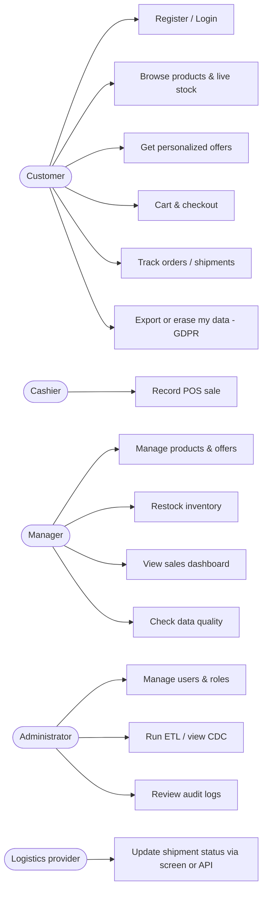
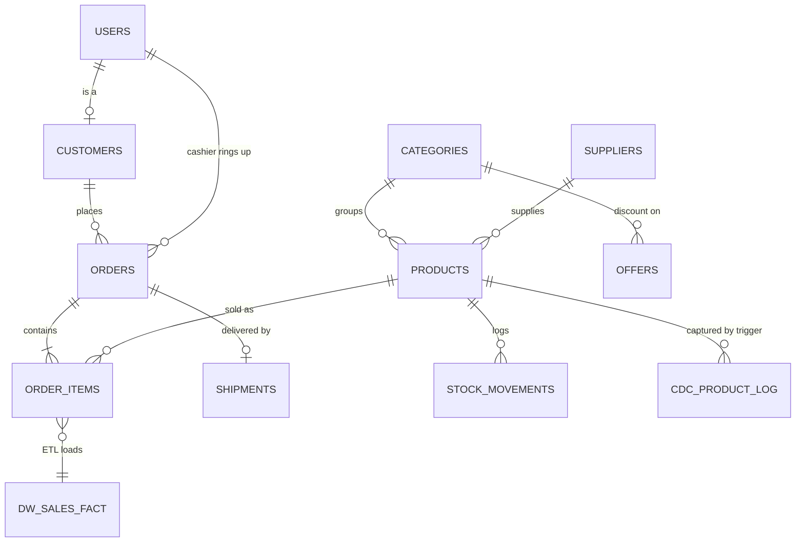

# 🛍️ EDM Retail — Retail & E-Commerce Website with Enterprise Data Management

A retail web application built for the **Enterprise Data Management (EDM)** subject.
*"EDM Integration — Unifying Data for Governance, Quality, and Insights"*,
specifically the **Retail & E-Commerce** case (POS + Inventory + CRM + Online Storefront + Logistics).

| Layer | Technology |
|---|---|
| Front-end | HTML5, CSS3, JavaScript, Bootstrap 5 (CDN), Chart.js (CDN) |
| Back-end | PHP 8+ (PDO, sessions) |
| Database | MySQL / MariaDB |
| Server | XAMPP (Apache + MySQL) |
| IDE | Visual Studio Code |
| Optional | Git / GitHub |

---

## 1. Actors (who uses the system)

| # | Actor | Type | What they do | Main pages |
|---|---|---|---|---|
| 1 | **Customer** | Primary (external) | Register, log in, browse products, see live stock and personalized offers, add to cart, check out, track shipments, view order history and loyalty points, export or delete own data (GDPR) | `index.php`, `products.php`, `cart.php`, `checkout.php`, `orders.php`, `profile.php` |
| 2 | **Cashier** | Primary (staff) | Records walk-in sales at the in-store POS (optionally linked to a customer's email for loyalty and offers) | `pos/index.php` |
| 3 | **Inventory / Store Manager** | Primary (staff) | Manages product master data, restocks and adjusts inventory, creates personalized offers, cancels orders, monitors sales dashboard and data quality | `admin/index.php`, `products.php`, `inventory.php`, `orders.php`, `offers.php`, `quality.php` |
| 4 | **Administrator** | Primary (staff) | Everything the manager does **plus** user and role management, runs the ETL, views CDC log and the full audit trail | `admin/users.php`, `etl.php`, `audit.php` |
| 5 | **Logistics Provider (Courier)** | Secondary (external system / staff) | Updates shipment status (`picked_up → in_transit → delivered`) through the screen or the REST API | `admin/shipments.php`, `api/shipment.php` |
| 6 | **MySQL / ETL job** | Secondary (system actor) | Triggers capture price/stock changes (CDC); the ETL moves cleaned sales data into the warehouse tables | `database/schema.sql`, `includes/etl.php` |

### Use-case diagram



**Role-based access control (RBAC)** — every page calls `require_role(...)`; a wrong role receives `403`.

| Page group | admin | manager | cashier | logistics | customer |
|---|:-:|:-:|:-:|:-:|:-:|
| Storefront, cart, checkout, my orders, profile | – | – | – | – | ✅ |
| POS terminal | ✅ | – | ✅ | – | – |
| Dashboard, products, inventory, orders, offers, data quality | ✅ | ✅ | – | – | – |
| Shipments | ✅ | ✅ | – | ✅ | – |
| Users, ETL/CDC, audit logs | ✅ | – | – | – | – |

---

## 2. How the project follows the presentation

| Slide topic | Where it is implemented |
|---|---|
| **Retail & E-Commerce data sources** (POS, inventory, CRM, storefront, logistics) | Tables `orders` (channel `online`/`pos`), `products`, `customers`, `shipments` |
| **Integration goal: real-time stock updates** | One order engine (`includes/orders.php`) used by BOTH POS and storefront; row locking + stock deduction in a transaction; `api/stock.php` is polled every 10 s by `assets/js/app.js` |
| **Integration goal: personalized customer offers** | `eligible_offers()` uses the customer's purchase history (CRM) → category discounts shown on the storefront and applied at checkout |
| **Integration goal: unified sales reporting** | View `v_sales_unified` (POS + online in one place) feeds the dashboard |
| **Integration methods: Real-time APIs** | `api/stock.php` (public, read-only) and `api/shipment.php` (secured with API key) |
| **Integration methods: CDC** | MySQL triggers `trg_products_cdc_*` write every price/stock change to `cdc_product_log` |
| **Integration methods: Data Virtualization** | SQL view `v_sales_unified` — unified access without moving data |
| **ETL (Extract → Transform → Load)** slides 4–7 | `includes/etl.php` + `admin/etl.php` → warehouse tables `dw_sales_fact`, `dw_daily_sales` |
| **Transform examples** (standardize names, remove duplicates, convert dates, business rules) | `PEDRO PENDUKO → Pedro Penduko`, walk-in label, `Y-m-d` dates, cancelled/invalid rows rejected, `UNIQUE(order_item_id)` blocks duplicates |
| **Governance: PCI DSS** | No card data is ever requested or stored (payment methods are simulated) |
| **Governance: GDPR** | Consent checkbox + timestamp, data export (JSON), right to erasure (anonymization), password hashing |
| **Governance: role-based access, audit trails, encryption** (slide 9) | RBAC per page, `audit_logs` table (who/what/when/IP, old & new values), `password_hash()` (bcrypt), prepared statements, CSRF tokens |
| **DQM** (slides 3, 11) | `admin/quality.php` — 10 automatic rules (completeness, validity, uniqueness, accuracy, consistency, integrity, timestamp consistency, timeliness) with a quality score |
| **Challenges** (seasonal spikes, data consistency across channels) | Transactions + `SELECT … FOR UPDATE` prevent overselling when POS and web buy the last item at the same time |
| **Best practices** (slide 12) | Governance built in from the start, automated quality checks, outcome reports (dashboard) |

---

## 3. Folder structure

```
edm-retail/
├── README.md
├── index.php  products.php  cart.php  checkout.php  orders.php   ← customer storefront
├── login.php  register.php  logout.php  profile.php
├── pos/index.php                    ← cashier POS terminal
├── admin/                           ← staff back-office
│   ├── index.php (dashboard)  products.php  inventory.php  orders.php
│   ├── shipments.php  offers.php  users.php
│   └── quality.php  etl.php  audit.php
├── api/
│   ├── stock.php                    ← real-time stock (GET, public)
│   └── shipment.php                 ← logistics updates (POST, API key)
├── includes/                        ← shared code
│   ├── bootstrap.php  functions.php (security, RBAC, audit)
│   ├── orders.php (order engine)  etl.php  shipping.php
│   └── header.php  footer.php  staff_nav.php
├── config/config.php  db.php        ← settings + PDO connection
├── assets/css/style.css  assets/js/app.js
└── database/schema.sql              ← tables, view, triggers, seed data
```

### Database (simplified ERD)



---

## 4. Installation (XAMPP + VS Code)

1. **Install XAMPP** (PHP 8.0 or newer) and open the **XAMPP Control Panel**.
2. **Copy this folder** to `C:\xampp\htdocs\edm-retail` (the folder name must stay `edm-retail`, or change `BASE_URL` in `config/config.php`).
3. **Start Apache and MySQL** in the control panel.
4. **Import the database**
   - Open <http://localhost/phpmyadmin> → **Import** → choose `database/schema.sql` → **Go**.
   - (This creates the database `edm_retail`, all tables, the view, triggers and demo data. Re-importing resets everything.)
5. Check `config/config.php` — the XAMPP defaults (`root`, empty password) already work.
6. Open **<http://localhost/edm-retail/>**.
   - If Apache uses another port (e.g. 8080): `http://localhost:8080/edm-retail/`.
7. Open the folder in **VS Code** (`File → Open Folder`). Recommended extensions: *PHP Intelephense*, *Live Share* (team work).

### Demo accounts (password for all: `Password@123`)

| Actor | Email |
|---|---|
| Administrator | `admin@edmretail.test` |
| Manager | `manager@edmretail.test` |
| Cashier | `cashier@edmretail.test` |
| Logistics | `logistics@edmretail.test` |
| Customer | `kenji@gmail.com` (likes beverages), `angelica@gmail.com` (likes grocery), `pedro@edmretail.test` (incomplete profile) |

> ⚠️ Change the passwords and `LOGISTICS_API_KEY` before putting this anywhere public.

---

## 5. Suggested demo flow for your presentation

1. **Customer** (`kenji@…`): open *Products* → note the **-10 % beverage offer** and the live stock badge → add items → check out.
2. **Cashier** (`cashier@…`): sell the same product at the POS. Go back to the storefront: the stock number changes by itself within 10 seconds (**real-time integration**).
3. **Logistics** (`logistics@…`): set Maria's shipment to *in transit* → *delivered*. Maria's order page follows (**data consistency across systems**).
4. **Manager** (`manager@…`): restock a low-stock item; check the **Dashboard** (unified POS + online sales via the SQL view) and **Data Quality** (score + incomplete customer *Pedro Penduko*).
5. **Admin** (`admin@…`): open **ETL / CDC** → *Run ETL now* → show Extract/Transform/Load numbers (e.g. `PEDRO PENDUKO → Pedro Penduko`); run it again → 0 loaded, all duplicates skipped. Show the **CDC log** (price/stock changes captured by triggers) and the **Audit Logs**.
6. **Customer → Profile**: *Download my data* (GDPR access) and *Delete my account* (GDPR erasure).

---

## 6. REST API reference

**Real-time stock** — public, read-only

```bash
curl http://localhost/edm-retail/api/stock.php
curl "http://localhost/edm-retail/api/stock.php?sku=EL-003"
```

**Logistics update** — requires header `X-API-KEY` (see `config/config.php`)

```bash
curl -X POST http://localhost/edm-retail/api/shipment.php \
  -H "X-API-KEY: edm-logistics-demo-key-2026" \
  -H "Content-Type: application/json" \
  -d '{"tracking_no":"TRK00000101","status":"in_transit"}'
```
Allowed status: `pending`, `picked_up`, `in_transit`, `delivered`, `failed`. Find tracking numbers on the *Shipments* page.

---

## 7. Security & governance summary

- Passwords stored with `password_hash()` (bcrypt); never in plain text.
- All SQL uses **PDO prepared statements** (SQL-injection safe); all output escaped with `e()` (XSS safe).
- **CSRF token** on every POST form; session id regenerated at login.
- Login **brute-force limit** (5 failed attempts / 10 min / IP).
- **RBAC** enforced server-side on every page and API.
- **Audit trail** for logins, orders, stock, price, user, ETL and GDPR actions.
- **PCI DSS**: no card numbers collected. **GDPR**: consent, export, erasure.

## 8. Troubleshooting

| Problem | Fix |
|---|---|
| "Database connection failed" | Start **MySQL** in XAMPP, import `schema.sql`, check `config/config.php` |
| Pages open but links 404 | Folder must be `htdocs/edm-retail` or update `BASE_URL` |
| Import error near `DELIMITER` | Use phpMyAdmin's *Import* tab (not the SQL box), or `mysql -u root < database/schema.sql` |
| Page looks unstyled | Bootstrap/Chart.js load from a CDN — you need internet access |
| Locked out after failed logins | Wait 10 minutes, or run `DELETE FROM audit_logs WHERE action='LOGIN_FAILED';` |

## 9. Git / GitHub (optional)

```bash
cd C:\xampp\htdocs\edm-retail
git init
git add .
git commit -m "Initial commit: EDM Retail project"
git branch -M main
git remote add origin https://github.com/<your-username>/edm-retail.git
git push -u origin main
```
Suggested workflow for the group: one branch per feature (`feature/pos`, `feature/etl`, …), pull request → review → merge into `main`.

## 10. Possible improvements

Real payment gateway (PCI-compliant), email notifications, scheduled ETL (Windows Task Scheduler running a CLI script), product images upload, supplier purchase orders, CSV export of reports, unit tests.

---
*Project for Enterprise Data Management — Retail & E-Commerce integration case.*
